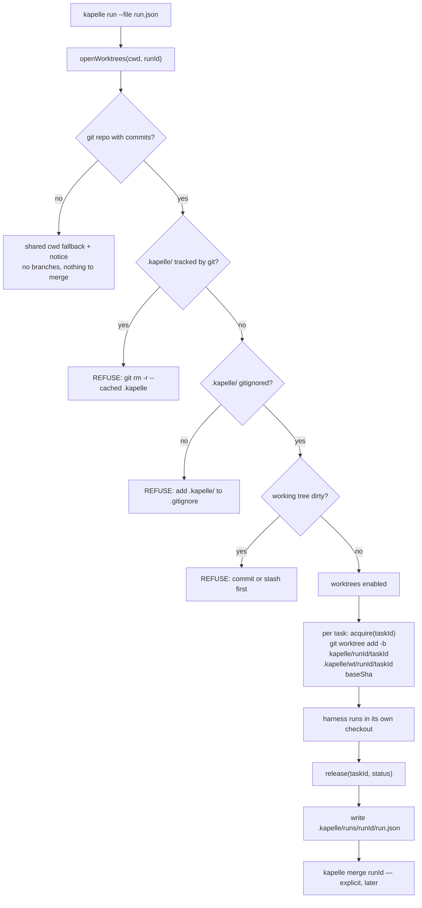
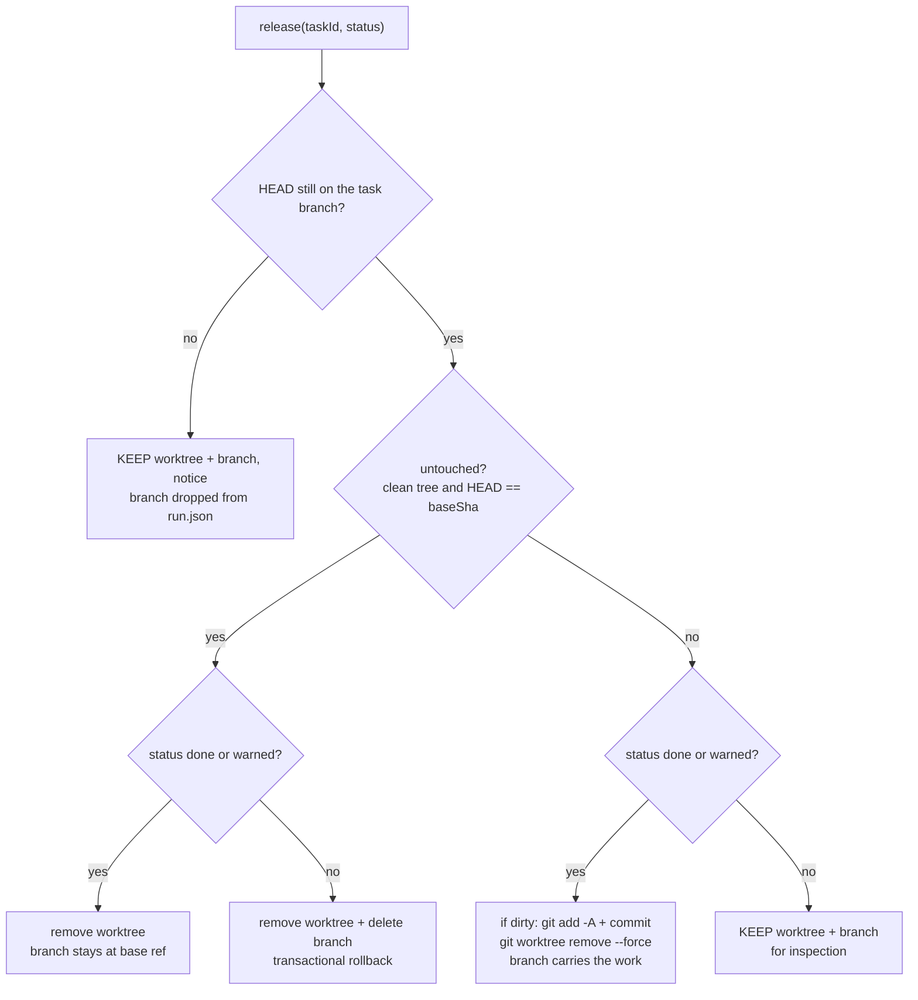
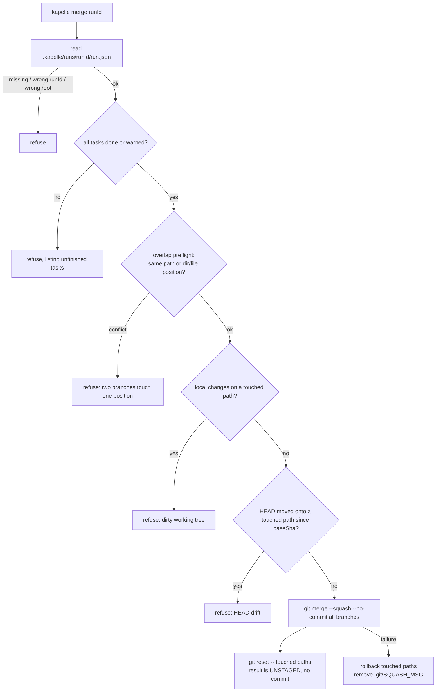
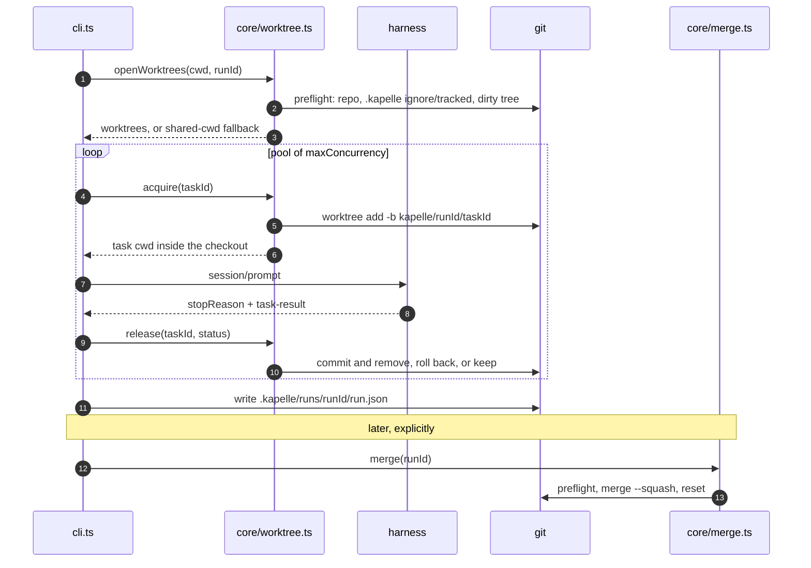

# M1 — Complete Summary

**Status.** All M1 stories are done and merged. The next milestone is M2,
the daemon.

M1 turns the ACP client into a single-process supervisor: one prompt, or N
independent tasks from a JSON run file, each harness in its own git worktree,
with watchdogs, a result contract, an explicit merge, and a terminal renderer.

## Delivered functionality

### M1a — protocol and policy core

| # | Functionality |
| --- | --- |
| 1 | **Harness registry** (`protocol/registry.ts`) — measured launch specs for opencode, claude-agent-acp, copilot and pi-acp; unverified entries for omp and gemini; per-harness mode maps, usage semantics, maxMode ceiling and measuredOn build stamps. Version drift warns, never fails. |
| 2 | **Env and secret hygiene** — `KAPELLE_*` variables are stripped from every spawned harness; the claude entry additionally unsets parent-session markers. |
| 3 | **ACP client** (`protocol/agent.ts`) — JSON-RPC over stdio, handshake, `session/new`, `session/prompt`; 30 s deadline on handshake and session-management calls, never on a prompt; the whole `PromptResponse` is kept, including `usage`. |
| 4 | **One turn at a time** — enforced, not advised: a second `session/prompt` during a live turn throws (M0-4 measured that a second prompt kills or poisons the running turn). |
| 5 | **Client-served file operations** — `fs/read_text_file` and `fs/write_text_file` with a path guard (`..`, absolute paths and symlink escapes refused) and a policy check on writes, so a harness cannot mutate by skipping the permission request. |
| 6 | **Permission decisions** — allow once, allow always or reject; an approval covers exactly one write and is consumed; denials are sticky; approval for one path never covers another. |
| 7 | **Payload hygiene** — malformed lines are ignored, oversized lines (over 32 MiB) are dropped with a stderr notice while the turn continues; synthetic `_client_*` events report cancel intent, permissions, writes and stalls. |
| 8 | **Modes and policy** (`core/policy.ts`) — `ask` (reads auto-approved, mutations prompt), `safe` (reads only, with a non-suppressible containment notice) and `auto`. Precedence is task, then run, then harness, then default; exceeding a harness ceiling is a validation error, never a downgrade. `safe` negotiates `session/set_mode` before the first prompt. |
| 9 | **Event bus and renderer** (`core/events.ts`, `render.ts`) — the bus carries wire objects; the renderer prints message and thought chunks, tool calls, diffs, plans, usage and permission lines. |
| 10 | **Run and task ids** (`core/ids.ts`) — `newRunId`, strict `assertTaskId` (never sanitised) and `kapelle/<runId>/<taskId>` branch names validated against real `git check-ref-format`. |
| 11 | **Toolchain and CI** — TypeScript strict, Biome, knip and `node:test`; CI runs `fmt:check`, `check`, `test`, `selftest` and `knip`. |

### M1b — run engine

| # | Functionality |
| --- | --- |
| 12 | **JSON run files** (`core/runfile.ts`, `schema/run.schema.json`) — run defaults plus `tasks[]` with `id`, `agent`, `prompt`, `mode`, `needs[]`, `worktree` and `allowReadOutsideRoot`, and `maxConcurrency` (default 4). The runtime validator is the single source of truth; the schema is an editor aid only. |
| 13 | **Pre-spawn refusals** — duplicate task ids, non-empty `needs` and inheritance `worktree` are rejected naming M3, a mode above `maxMode` is rejected naming both values, and bad `maxConcurrency` is rejected. `--file` also refuses `--agent`, `--cmd`, `--mode` and an extra prompt. |
| 14 | **Run engine** (`core/run.ts`) — N tasks in a concurrency pool; each task owns one agent, one worktree, one policy and one result. The run roll-up is status, duration and turn count; token figures stay per task, tagged with their harness, never summed. |
| 15 | **Status model** — a stop-reason table maps `end_turn` to done, `max_tokens`, `max_turn_requests` and `refusal` to failed, and cancels to timed out or cancelled, keyed on the supervisor's own cancel and watchdog record because copilot reports `end_turn` for a turn it cancelled. Severity order: done, warned, cancelled, skipped, timed out, failed. |
| 16 | **Worktrees** (`core/worktree.ts`) — one checkout per task under `.kapelle/wt/<runId>/<taskId>`; preflight refuses dirty trees and an unignored `.kapelle/`; success commits to the task branch and releases; failure and timeout keep worktree and branch; a non-git cwd falls back to shared cwd with a never-suppressed notice. HEAD-moved, subdirectory and symlink guards included. |
| 17 | **Result contract** (`core/result.ts`) — a prompt preamble requesting a `task-result` block, strict extraction of `status`, `summary` and `details` plus optional `files` and `branch`, and a synthesised summary (flagged as synthesised) when the block is missing. Never a retry prompt. |
| 18 | **Cross-check warnings** — claimed success with an empty diff, `files` not present in the diff, a changed tree with no block, `policyNeverFired`, and `filesUnclaimed` (added during M1c-6). Warnings promote done to warned and never fail a task. |
| 19 | **Durable state** — `.kapelle/runs/<runId>/run.json`, which merge reads, plus `.kapelle/runs/<runId>/<taskId>.stderr.log` written unconditionally so spawn errors survive the terminal. |
| 20 | **Offline fixtures** — `mock-agent.mjs` with `--scenario` covering permission timeout, missing and malformed blocks, every warning kind, stall, repeat and usage; `hostile-agent.mjs` with eight attacks (path escape, symlink, unasked write, malformed JSON-RPC, flood, unknown method and more), each asserting containment and that the turn still ends. |
| 21 | **Ask handling in run files** — exactly one asker survives, and only with a TTY; otherwise ask re-resolves to safe with a notice. |
| 22 | **`fanout.mjs` retired** — `tasks.json` is now the worked run-file example. |

### M1c — liveness, merge and the M1 bar

| # | Functionality |
| --- | --- |
| 23 | **Watchdog** (`core/watchdog.ts`) — one timer over all tasks; idle and repeat signals warn while the task keeps running; the longer TTL sends `session/cancel`, waits 2 s, then force-kills and marks the task timed out from the supervisor's own record. Every knob is disabled at 0, and one task's failure cannot halt the sweep. |
| 24 | **Notifier** (`core/notify.ts`) — terminal bell, stderr line and best-effort `notify-send` or `osascript`; fires on a stall and on `_client_permission_pending` (emitted before the policy awaits), skips auto-approved read-only decisions, and survives `--quiet`. |
| 25 | **Merge** (`core/merge.ts`) — `kapelle merge <runId>`, never automatic. Refuses unfinished tasks, overlapping branches, a dirty working tree on touched paths and current-HEAD drift, then runs `git merge --squash` followed by `reset` so the result lands unstaged, with rollback on failure. `--rebase` is refused until M3-4. |
| 26 | **Markdown rendering** (`core/markdown.ts`) — `marked` pinned exactly under the presentation-only dependency exception, ANSI paint written here, streaming block repaint on a TTY, and a raw-text fallback on non-TTY, `NO_COLOR` or renderer failure. |
| 27 | **Package identity** — package and command renamed to kapelle, a `bin` entry with `npm link`, the front end renamed `run.ts` to `cli.ts`, `.kapelle/` as the state directory, and macOS and Linux only (Windows fails `npm install` with `EBADPLATFORM`). |

### M1c-6 — acceptance

- **Four-harness acceptance run.** opencode 1.18.30, claude-agent-acp 0.75.1, copilot 1.0.83 and pi-acp in one `maxConcurrency: 4` run: each in its own worktree with a parsed result and a stderr log; `git worktree list` clean afterwards; `kapelle merge` landing all four as unstaged additions.
- **`filesUnclaimed`.** The fifth result cross-check: the diff holds paths `files` never named. The pi task exposed it when the pi-lens extension wrote eight telemetry files into the workspace while the result named only `NOTE-pi.md`. Fixture `--scenario files-unclaimed` and tests included.
- **Unknown-tree guard.** `changed: undefined` stays unknown, never empty, so no tree-shaped check fires outside a repository or in the shared-cwd fallback.
- **Hostile-agent fix.** `in` became `Object.hasOwn`, so `--scenario constructor` can no longer pass a containment test by running no attack at all.
- **Documentation sweep.** Corrected the devDependency list, the runtime-dependency rule, three to four harness targets, orphan-reap ownership (M2-5) and the README `core/` list.

## Commands available today

```bash
kapelle "<prompt>" [--agent <id>|--cmd "<cmd>"|--cwd <dir>|--mode <mode>|--verbose|--quiet]
kapelle run --file tasks.json [--cwd <dir>|--verbose|--quiet]
kapelle merge <runId> [--squash] [--cwd <dir>]
```

Modes are `ask`, `safe` and `auto`. Exit codes are 0 for done or warned, 1 for
failure and 130 for operator cancellation.

State left behind: `.kapelle/wt/<runId>/<taskId>`, `.kapelle/runs/<runId>/`
with `run.json` and `<taskId>.stderr.log`, and `kapelle/<runId>/<taskId>`
branches.

## Worktree lifecycle

### Preflight, acquisition and release



### What `release` keeps or removes



Teardown never changes the verdict: a failed commit or removal is a notice,
not a reason to relabel a task that finished.

### Disk and ref layout

```text
repo root/
├── .git/
│   └── refs/heads/kapelle/<runId>/<taskId>   survives release; merge reads this
├── .kapelle/                                 gitignored, never committed
│   ├── wt/<runId>/<taskId>/                  live checkout, removed on success
│   └── runs/<runId>/
│       ├── run.json                          merge's input
│       └── <taskId>.stderr.log
└── (your checkout — untouched until merge)
```

## Merge pipeline



Invariants:

- Merge is never automatic; it is a separate operator act.
- Preflight completes before any write; a run never half-lands.
- Worktrees are disposable, branches are the output.
- `--squash` is the only mode in M1; `--rebase` is refused until M3-4.

## End-to-end sequence



## Deliberately not in M1

- Daemon, HTTP API, SSE and the N-asker permission queue — M2.
- DAG, pipeline handoff, `needs[]` execution and `merge --rebase` — M3.
- Dashboard — M4.
- Harness terminals (`terminal/*`) — cut by the M0-3 finding.
- Crash-recovery sweep and orphan reaping — M2-5, which needs persisted records.
- Sandboxing — deferred with an event trigger, not a judgement.

## Where things live

| Path | Role |
| --- | --- |
| `protocol/` | Wire-level types, the ACP client and the harness registry. |
| `core/` | Supervisor logic: policy, events, run files, run engine, worktrees, merge, results, watchdog, notify, ids, markdown. |
| root scripts | `cli.ts` (the `kapelle` bin), `render.ts`, `mock-agent.mjs`, `hostile-agent.mjs`. |
| `schema/run.schema.json` | Editor aid for authoring run files; not a runtime validator. |
| `docs/` | Plans, stories, findings and this summary. |
| `tests/`, `core/tests/`, `protocol/tests/`, `integration/` | Pure-function suites, protocol suites and real-harness integration tests. |

## Verification

`npm run test` covers the pure functions and protocol behaviour offline;
`npm run check`, `npm run fmt:check`, `npm run selftest` and `npm run knip`
must stay green; `npm run test:harness` drives the real harness integration
tests; CI runs the same set. The offline property is deliberate: every client
path is exercisable with nothing installed, through the mock and hostile
fixtures.
